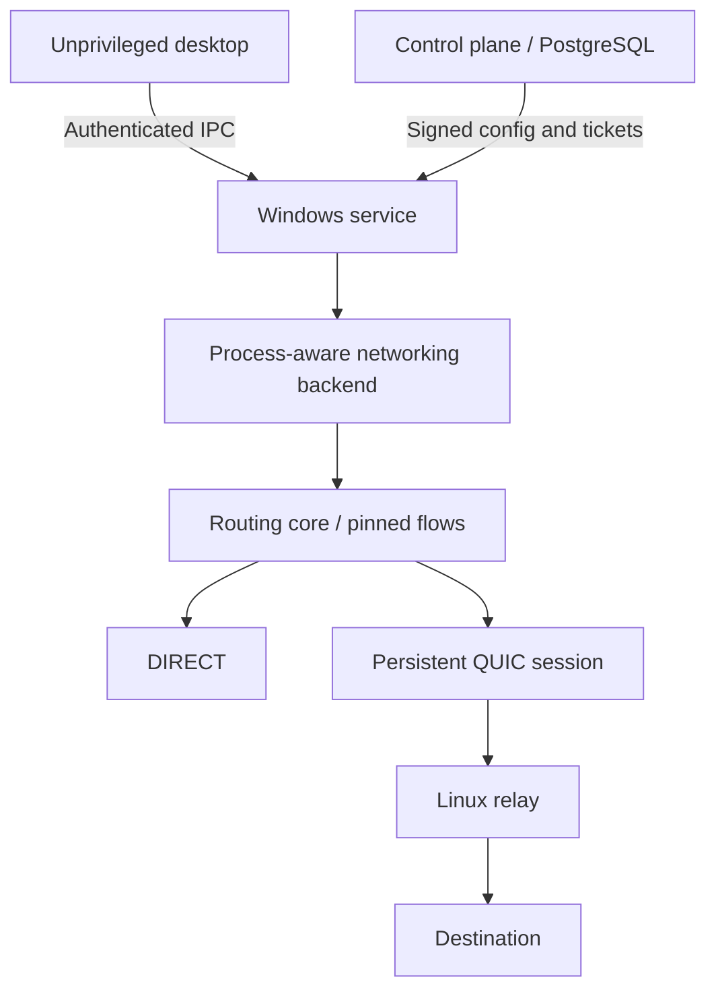

# Architecture

Go is shared by core, relay and planned control plane. UI never forwards packets.
Unknown process, invalid measurement or unavailable relay defaults to DIRECT.
Already established TCP connections never migrate. Control plane is outside the data path.
See ADRs and docs/STATUS.md for implemented boundaries.
